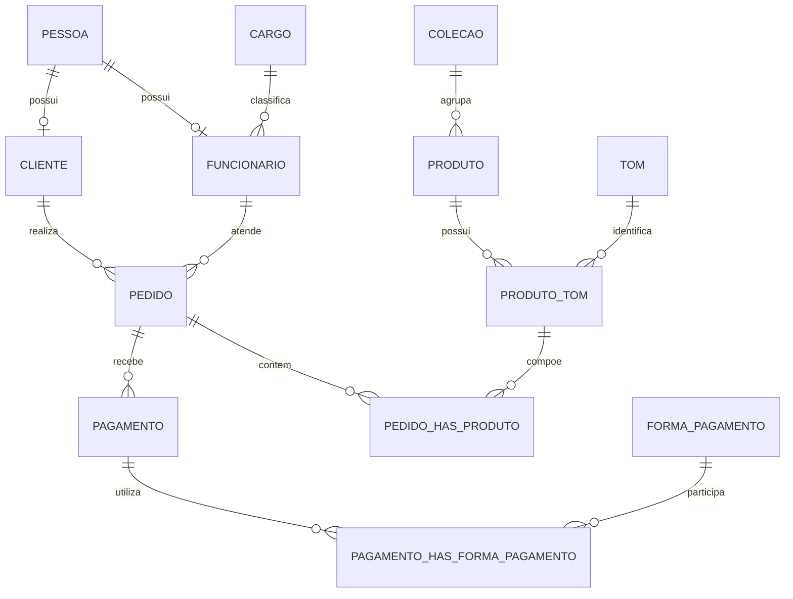

# Loja Kiko Milano — Sistema Web

Aplicação web de uma loja de maquiagens, desenvolvida como projeto acadêmico de Desenvolvimento Web I. O sistema simula a operação de uma loja virtual, com catálogo de produtos, variações de tons, cadastro de pessoas, clientes e funcionários, pedidos e gerenciamento administrativo.

## Tecnologias utilizadas

- **Front-end:** HTML5, CSS3 e JavaScript.
- **Back-end:** Node.js e Express.
- **Banco de dados:** PostgreSQL.
- **Acesso ao banco:** biblioteca `pg`.
- **Sessão e autenticação:** cookies, com `cookie-parser`.
- **Upload e tratamento de imagens:** `multer` e `canvas`.
- **Outras dependências:** `axios`, `cors`, `dotenv` e `nodemailer`.

## Organização do projeto

```text
LojaKiko_corrigido/
├── backend/
│   ├── controllers/       # Lógica das funcionalidades
│   ├── routes/            # Rotas e endpoints da aplicação
│   ├── database.js        # Conexão com PostgreSQL
│   └── server.js          # Inicialização do servidor
├── documentacao/
│   ├── scriptCandyShop.sql
│   ├── scriptsql.sql
│   └── tutorial.md
├── frontend/              # Páginas HTML, CSS e JavaScript
│   ├── cadastros/
│   ├── login/
│   ├── pessoa/
│   ├── produto/
│   ├── pedido/
│   ├── pagamento/
│   ├── funcionario/
│   ├── cliente/
│   └── visaoCliente/
├── imagens/
│   ├── produto/
│   └── produtos/
├── index.html
├── package.json
├── package-lock.json
├── .gitignore
└── README.md
```

## Arquitetura do sistema

O projeto utiliza a arquitetura Cliente/Servidor e segue o padrão MVC (Model-View-Controller).

- **View:** páginas HTML, arquivos CSS e JavaScript localizados em `frontend/`.
- **Controller:** arquivos em `backend/controllers/`, responsáveis pela lógica das operações.
- **Router:** arquivos em `backend/routes/`, responsáveis por mapear as requisições para os controllers.
- **Model/Dados:** acesso ao PostgreSQL centralizado em `backend/database.js`, utilizado pelos controllers.

## Funcionalidades

### Área do cliente

- Visualização do catálogo de produtos.
- Consulta dos detalhes dos produtos e de suas variações de tons.
- Carrinho de compras.
- Fluxo de finalização e consulta de pedidos.
- Cadastro e autenticação de usuários.

### Área administrativa

- Acesso aos cadastros e gerenciamento de pessoas.
- Gerenciamento de clientes e funcionários.
- Gerenciamento de cargos.
- Cadastro e manutenção de produtos, coleções, categorias e tons.
- Gerenciamento de pedidos e informações de pagamento.
- Cadastro e exibição de imagens dos produtos e de suas variações.

O projeto possui fluxo de autenticação e logout com uso de cookies, além de seleção do perfil de acesso para usuários que possuem acesso como cliente e funcionário.

**Observação sobre pagamentos:** o sistema mantém telas e registros relacionados a pedidos e pagamentos. A integração com serviços ou gateways reais de pagamento não faz parte do escopo implementado.

## Banco de dados

O banco de dados relacional utiliza PostgreSQL. As tabelas principais representam pessoas, clientes, funcionários, cargos, coleções, produtos, tons, pedidos e pagamentos.

### Relacionamentos principais

- **Cargo 1:N Funcionário:** um cargo pode estar associado a vários funcionários.
- **Coleção 1:N Produto:** uma coleção pode conter vários produtos.
- **Pessoa 1:1 Cliente:** o registro de cliente utiliza o CPF da pessoa como chave primária e estrangeira.
- **Pessoa 1:1 Funcionário:** o registro de funcionário utiliza o CPF da pessoa como chave primária e estrangeira.
- **Cliente 1:N Pedido:** um cliente pode realizar vários pedidos.
- **Funcionário 1:N Pedido:** um funcionário pode estar associado a vários pedidos.
- **Pedido 1:N Pagamento:** um pedido pode possuir registros de pagamento.
- **Produto N:N Tom:** a tabela intermediária `produto_tom` relaciona produtos e tons.
- **Pedido N:N Produto_Tom:** a tabela intermediária `pedido_has_produto` registra os itens de cada pedido.
- **Pagamento N:N Forma_Pagamento:** a tabela `pagamento_has_forma_pagamento` relaciona pagamentos e formas de pagamento.

### Diagrama do banco de dados



### Scripts SQL

Os scripts de criação e carga inicial estão na pasta `documentacao/`:

- `scriptCandyShop.sql`: script com a estrutura e os dados de exemplo do catálogo da Loja Kiko.
- `scriptsql.sql`: outro script de criação e carga do banco mantido na documentação.
- `dumpDBeaver-candyshop-202511180647.sql`: arquivo de exportação do banco.

**Atenção:** os scripts de criação começam removendo tabelas existentes (`DROP TABLE ... CASCADE`) antes de criá-las novamente. Execute em um banco de desenvolvimento ou teste, ou faça backup antes. Não execute em um banco com dados que deseja preservar.

## Requisitos para execução

Instale previamente:

1. [Node.js](https://nodejs.org/)
2. [PostgreSQL](https://www.postgresql.org/)
3. Um cliente PostgreSQL, como pgAdmin ou DBeaver (opcional).

## Configuração do ambiente

1. Crie um banco de dados PostgreSQL para o projeto.
2. Na pasta raiz `LojaKiko_corrigido/`, crie um arquivo chamado `.env`.
3. Configure as variáveis de ambiente com os dados do seu banco:

```env
# Servidor
PORT=3001
NODE_ENV=development

# PostgreSQL
DB_HOST=localhost
DB_PORT=5432
DB_NAME=nome_do_banco
DB_USER=seu_usuario
DB_PASSWORD=sua_senha

# E-mail (utilizado no fluxo de recuperação de senha)
SMTP_HOST=servidor_smtp
SMTP_PORT=587
SMTP_SECURE=false
SMTP_USER=seu_email
SMTP_PASS=sua_senha_ou_senha_de_aplicativo
SMTP_FROM=Nome da Loja <seu_email>
```

Substitua os valores de exemplo pelos dados reais do seu ambiente e pelas configurações SMTP do provedor de e-mail utilizado. Não compartilhe nem publique o arquivo `.env`.

O arquivo `backend/database.js` carrega as variáveis do `.env` localizado na raiz do projeto.

## Instalação e inicialização

Abra o terminal na pasta `LojaKiko_corrigido/` e execute:

```bash
npm install
```

Depois, crie as tabelas e insira os dados de exemplo executando o script SQL desejado no banco PostgreSQL. Para o catálogo da Loja Kiko, utilize `documentacao/scriptCandyShop.sql`.

Inicie o servidor com:

```bash
npm start
```

O comando executa `node backend/server.js`. Quando o servidor iniciar corretamente, acesse:

- **Aplicação:** http://localhost:3001
- **Menu:** http://localhost:3001/menu
- **Verificação da conexão com o banco:** http://localhost:3001/health

A porta padrão é `3001`. Se a variável `PORT` estiver configurada no `.env`, o servidor utilizará o valor informado.

## Rotas principais

As rotas são registradas em `backend/server.js`. Entre os grupos disponíveis estão:

| Caminho base | Finalidade |
|---|---|
| `/menu` | Menu e navegação principal |
| `/login` | Login, cadastro, escolha de perfil e logout |
| `/pessoa` | Cadastro e gerenciamento de pessoas |
| `/cliente` | Operações de clientes |
| `/funcionario` | Operações de funcionários |
| `/cargo` | Gerenciamento de cargos |
| `/produto` | Gerenciamento de produtos |
| `/categoria-produto` | Categorias de produtos |
| `/colecao` | Coleções |
| `/tom` | Tons e variações |
| `/pedido` | Pedidos |
| `/pagamento` | Registros de pagamento |
| `/forma_pagamento` | Formas de pagamento |

Cada grupo de rotas possui seu arquivo correspondente em `backend/routes/` e, quando aplicável, seu controller em `backend/controllers/`.

## Imagens dos produtos

O sistema permite enviar imagens locais ou informar uma URL de imagem no cadastro. Os arquivos processados são armazenados localmente nas pastas:

- `imagens/produto/`: imagens principais dos produtos.
- `imagens/produtos/`: imagens relacionadas às variações e tons dos produtos.

O back-end disponibiliza essas imagens por rotas estáticas e endpoints de visualização.

## Versionamento e segurança

O `.gitignore` do projeto ignora o diretório `node_modules/` e o arquivo `.env`. O arquivo `.env` contém credenciais e deve permanecer apenas no ambiente local. Para compartilhar o projeto, forneça somente os nomes das variáveis e valores fictícios em um arquivo de exemplo, nunca as senhas reais.

Antes de publicar o repositório, confira se o `.env` não foi adicionado ao controle de versão e se não há senhas ou dados pessoais reais nos scripts SQL de exemplo.

## Identificação acadêmica

- **Projeto:** Loja Kiko Milano
- **Disciplina:** Desenvolvimento Web I (DW1)
- **Período:** 4º bimestre de 2026
- **Aluna:** [Preencher nome completo]
- **Turma:** [Preencher turma]
